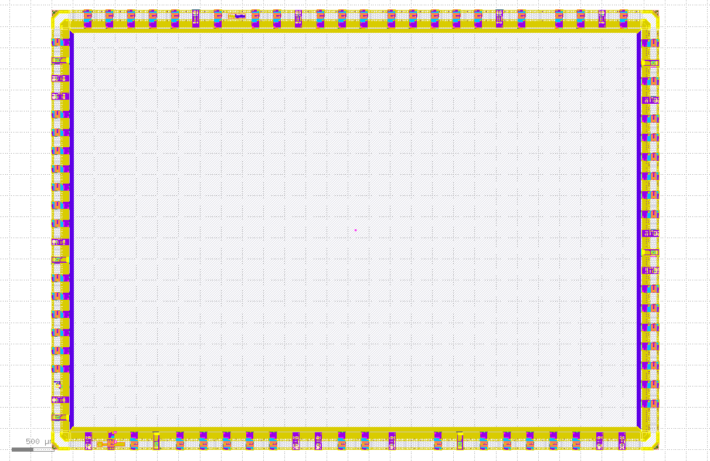
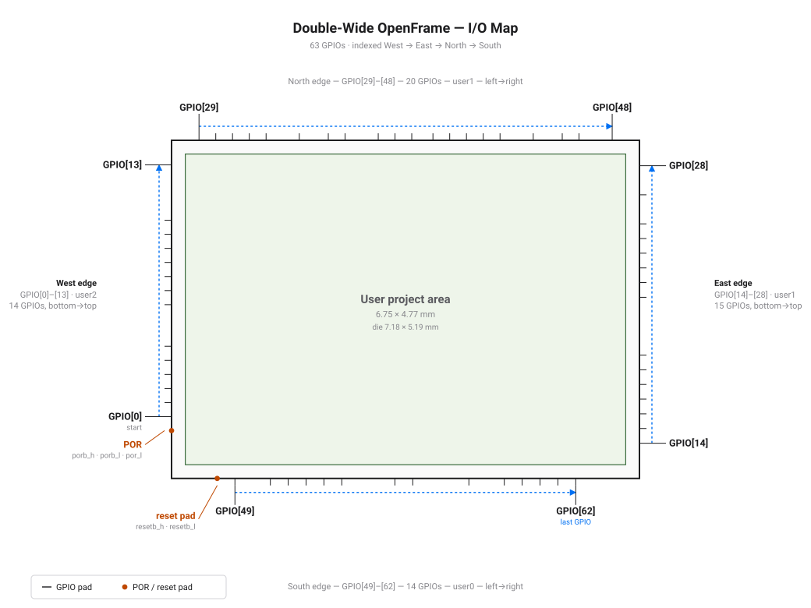
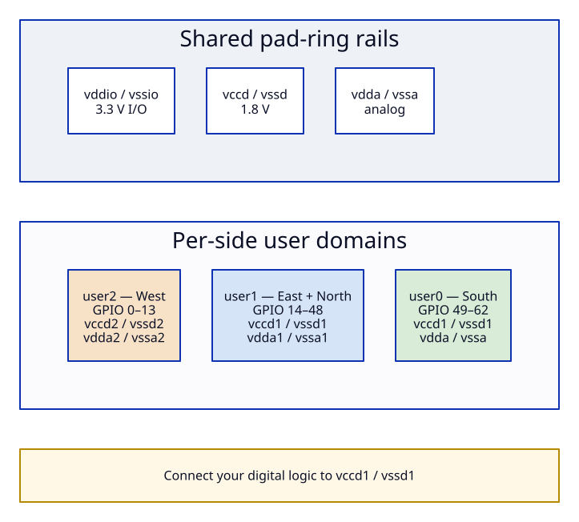
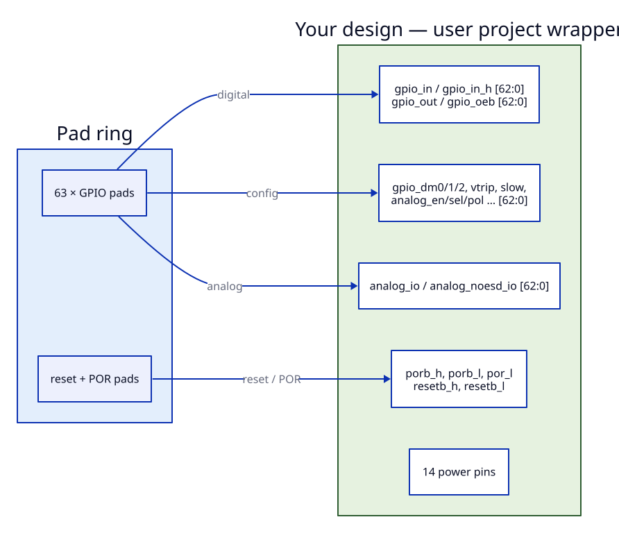

# Double-Wide OpenFrame Padframe — Datasheet

A **2×-wide** sky130 open-source padframe: a large empty user area surrounded by
a configurable GPIO pad ring. You build your design inside the user area,
connect to the boundary signals described here, and we integrate your hardened
block into the frame. There is no management processor — every pad is yours.

## Summary

| Parameter | Value |
|-----------|-------|
| **Die area** | **7176 × 5188 µm** (7.18 × 5.19 mm, ~37.2 mm²) |
| **User area** | **6754.63 × 4766.63 µm** (~32.2 mm²) |
| **GPIOs** | **63** configurable I/O (`gpio[62:0]`) |
| **Dedicated reset pad** | 1 — external `resetb`, 3.3 V, level-shifted to 1.8 V |
| **Power-on reset (POR)** | On-chip, delivered to your design (`porb_h`, `porb_l`, `por_l`) |
| **Power / analog domains** | Multi-domain: `user0`, `user1`, `user2` + shared IO/analog rails |
| **Process** | SkyWater sky130A (open PDK) |
| **I/O cells** | `sky130_ef_io` GPIOv2 (digital + analog capable, built-in ESD) |
| **Management SoC** | None — full pad control exposed to the user area |

Compared to the standard single-wide openframe (44 GPIOs, ~15 mm² user area),
the double-wide roughly **doubles the usable silicon area to ~32 mm²** and
raises the GPIO count to **63** while keeping the same pad interface.

---

## I/O map

GPIOs are numbered **West → East → North → South**. Each side maps to a power
domain; the on-chip POR sits in the west gap and the external reset pad is on
the south edge.

| Edge | GPIO indices | Count | Domain | Order |
|------|--------------|------:|:------:|-------|
| West | `gpio[0]`–`gpio[13]` | 14 | user2 | bottom → top |
| East | `gpio[14]`–`gpio[28]` | 15 | user1 | bottom → top |
| North | `gpio[29]`–`gpio[48]` | 20 | user1 | left → right |
| South | `gpio[49]`–`gpio[62]` | 14 | user0 | left → right |

Exact bond-pad coordinates for every index are in [pinout.md](pinout.md) and
[`../pad_summary.json`](../pad_summary.json).

---

## Power domains

The pad ring preserves the openframe multi-domain structure. Your logic can use
any domain, but **digital standard-cell logic should connect to `vccd1` /
`vssd1`**.

| Domain | GPIO sides | Core / analog rails |
|--------|------------|----------------------|
| **user0** | South (49–62) | `vccd1` / `vssd1`, `vdda` / `vssa` |
| **user1** | East (14–28), North (29–48) | `vccd1` / `vssd1`, `vdda1` / `vssa1` |
| **user2** | West (0–13) | `vccd2` / `vssd2`, `vdda2` / `vssa2` |
| Shared ring | all | `vddio` / `vssio` (3.3 V I/O), `vccd` / `vssd`, `vdda` / `vssa` |

Power is delivered through **24 clamped power bond pads** (per-net counts in
[pinout.md](pinout.md)). Bring your own in-area power distribution (PDN) when you
harden your design.

---

## GPIO interface

Each of the 63 pads is a sky130 GPIOv2 cell. Its full control and data set
appears on the user-area boundary as `[62:0]` vectors — one bit per GPIO. Your
design drives the configuration and reads/writes data; there is no boot
controller, so **your logic is responsible for configuring each pad**.

| Signal | Dir (from user) | Width | Purpose |
|--------|:---------------:|------:|---------|
| `gpio_in` | in | 63 | Input data (1.8 V core side) |
| `gpio_in_h` | in | 63 | Input data (3.3 V high side) |
| `gpio_out` | out | 63 | Output data |
| `gpio_oeb` | out | 63 | Output enable, active-low (1 = input) |
| `gpio_inp_dis` | out | 63 | Input buffer disable |
| `gpio_ib_mode_sel` | out | 63 | Input buffer mode |
| `gpio_vtrip_sel` | out | 63 | Input trip-point select |
| `gpio_slow_sel` | out | 63 | Slew-rate control |
| `gpio_holdover` | out | 63 | Holdover latch control |
| `gpio_analog_en` | out | 63 | Analog mode enable |
| `gpio_analog_sel` | out | 63 | Analog select |
| `gpio_analog_pol` | out | 63 | Analog polarity |
| `gpio_dm0` / `gpio_dm1` / `gpio_dm2` | out | 63 | Drive-mode / pad-mode bits |
| `analog_io` | inout | 63 | Analog signal path (with ESD) |
| `analog_noesd_io` | inout | 63 | Analog signal path (no ESD) |

Typical digital use of one pad: set `gpio_oeb[i]=0` to drive `gpio_out[i]`, or
`gpio_oeb[i]=1` to read `gpio_in[i]`, with the analog and drive-mode controls in
their default (digital) state.

---

## Power-on reset and external reset

The frame provides an openframe-style reset cluster so your design comes up in a
known state without extra circuitry.

| Signal | Dir (from user) | Description |
|--------|:---------------:|-------------|
| `porb_h` | in | Power-on-reset bar, 3.3 V high side |
| `porb_l` | in | Power-on-reset bar, 1.8 V core side |
| `por_l` | in | Power-on-reset, 1.8 V core side |
| `resetb_h` | in | External reset bar from `resetb` pad, 3.3 V |
| `resetb_l` | in | External reset bar, level-shifted to 1.8 V |

`resetb_l` is the recommended reset for 1.8 V digital logic. `resetb` is a
dedicated bond pad on the south edge (it is not one of the 63 GPIOs).

---

## Designing in the user area

Your design is a single module that fills the user area and connects to the
boundary signals above.

| Requirement | Detail |
|-------------|--------|
| Module name | `double_wide_openframe_project_wrapper` |
| Port list | Must match the provided template exactly |
| Footprint | 6754.63 × 4766.63 µm (fixed) |
| Boundary pin locations | Fixed by the provided pin template |
| Recommended digital rails | `vccd1` / `vssd1` |
| Integration | Your hardened GDS is cell-swapped into the frame |

Flow at a glance:

1. Implement your logic inside `double_wide_openframe_project_wrapper` using the
   supplied empty template (module name + ports are fixed).
2. Harden it to GDS with LibreLane / `cf harden` at the fixed footprint.
3. Run precheck against this padframe as the golden reference.
4. We cell-swap your GDS into the frame to produce the final chip.