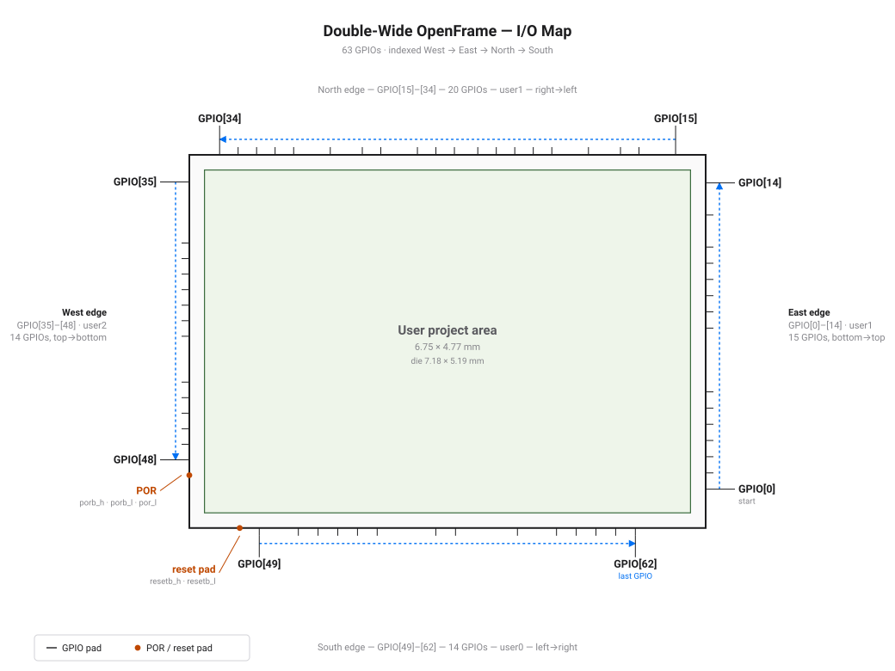

# Double-Wide OpenFrame — Pinout

GPIO indices and package bond-pad centers. Machine-readable source:
[`../pad_summary.json`](../pad_summary.json).

<!-- Tables below are AUTO-GENERATED by scripts/gen_datasheet_figures.py -->

## GPIO index map

Bond coordinate is the edge-local axis in µm (origin at die southwest):
West/East give **Y**, North/South give **X**.

| Index | Side | Domain | Bond coord (µm) |
|------:|:----:|:------:|----------------:|
| 0 | E | user1 | 537.500 |
| 1 | E | user1 | 763.500 |
| 2 | E | user1 | 988.500 |
| 3 | E | user1 | 1214.500 |
| 4 | E | user1 | 1439.500 |
| 5 | E | user1 | 1664.500 |
| 6 | E | user1 | 1890.500 |
| 7 | E | user1 | 2776.500 |
| 8 | E | user1 | 3002.500 |
| 9 | E | user1 | 3227.500 |
| 10 | E | user1 | 3453.500 |
| 11 | E | user1 | 3678.500 |
| 12 | E | user1 | 3903.500 |
| 13 | E | user1 | 4349.500 |
| 14 | E | user1 | 4795.500 |
| 15 | N | user1 | 6760.500 |
| 16 | N | user1 | 6251.500 |
| 17 | N | user1 | 5994.500 |
| 18 | N | user1 | 5549.500 |
| 19 | N | user1 | 5040.500 |
| 20 | N | user1 | 4782.500 |
| 21 | N | user1 | 4525.500 |
| 22 | N | user1 | 4268.500 |
| 23 | N | user1 | 4011.500 |
| 24 | N | user1 | 3686.500 |
| 25 | N | user1 | 3429.500 |
| 26 | N | user1 | 3172.500 |
| 27 | N | user1 | 2663.500 |
| 28 | N | user1 | 2406.500 |
| 29 | N | user1 | 1961.500 |
| 30 | N | user2 | 1452.500 |
| 31 | N | user2 | 1194.500 |
| 32 | N | user2 | 937.500 |
| 33 | N | user2 | 680.500 |
| 34 | N | user2 | 423.500 |
| 35 | W | user2 | 4813.500 |
| 36 | W | user2 | 3964.500 |
| 37 | W | user2 | 3748.500 |
| 38 | W | user2 | 3532.500 |
| 39 | W | user2 | 3316.500 |
| 40 | W | user2 | 3100.500 |
| 41 | W | user2 | 2884.500 |
| 42 | W | user2 | 2668.500 |
| 43 | W | user2 | 2030.500 |
| 44 | W | user2 | 1814.500 |
| 45 | W | user2 | 1598.500 |
| 46 | W | user2 | 1382.500 |
| 47 | W | user2 | 1166.500 |
| 48 | W | user2 | 950.500 |
| 49 | S | user0 | 969.500 |
| 50 | S | user0 | 1512.500 |
| 51 | S | user0 | 1786.500 |
| 52 | S | user0 | 2060.500 |
| 53 | S | user0 | 2334.500 |
| 54 | S | user0 | 2608.500 |
| 55 | S | user0 | 3422.500 |
| 56 | S | user0 | 3696.500 |
| 57 | S | user0 | 4557.500 |
| 58 | S | user0 | 5100.500 |
| 59 | S | user0 | 5374.500 |
| 60 | S | user0 | 5648.500 |
| 61 | S | user0 | 5922.500 |
| 62 | S | user0 | 6196.500 |

## Dedicated pads

| Pad | Side | Bond coord (µm) | Notes |
|-----|:----:|----------------:|-------|
| `resetb_pad` | S | 700.447 | External reset (3.3 V), level-shifted to 1.8 V |

## Power bond pads

| Net | Bond pads | Net | Bond pads |
|-----|----------:|-----|----------:|
| `vccd` | 1 | `vccd1` | 1 |
| `vccd2` | 1 | `vdda` | 2 |
| `vdda1` | 2 | `vdda2` | 1 |
| `vddio` | 2 | `vssa` | 2 |
| `vssa1` | 3 | `vssa2` | 1 |
| `vssd` | 2 | `vssd1` | 1 |
| `vssd2` | 1 | `vssio` | 4 |

**Total power bond pads:** 24.

## Ordered pad ring (per side)

Physical pad order around the ring (matches the manufacturing bond map).

### W — West

| # | Bond (µm) | Pad |
|--:|----------:|-----|
| 0 | 340.000 | VCCD |
| 1 | 551.000 | VDDIO |
| 2 | 908.000 | GPIO[48] |
| 3 | 1124.000 | GPIO[47] |
| 4 | 1340.000 | GPIO[46] |
| 5 | 1556.000 | GPIO[45] |
| 6 | 1772.000 | GPIO[44] |
| 7 | 1988.000 | GPIO[43] |
| 8 | 2204.000 | VSSD2 |
| 9 | 2415.000 | VDDA2 |
| 10 | 2626.000 | GPIO[42] |
| 11 | 2842.000 | GPIO[41] |
| 12 | 3058.000 | GPIO[40] |
| 13 | 3274.000 | GPIO[39] |
| 14 | 3490.000 | GPIO[38] |
| 15 | 3706.000 | GPIO[37] |
| 16 | 3922.000 | GPIO[36] |
| 17 | 4138.000 | VSSA2 |
| 18 | 4349.000 | VDDIO |
| 19 | 4560.000 | VCCD2 |
| 20 | 4771.000 | GPIO[35] |

### E — East

| # | Bond (µm) | Pad |
|--:|----------:|-----|
| 0 | 500.000 | GPIO[0] |
| 1 | 726.000 | GPIO[1] |
| 2 | 951.000 | GPIO[2] |
| 3 | 1177.000 | GPIO[3] |
| 4 | 1402.000 | GPIO[4] |
| 5 | 1627.000 | GPIO[5] |
| 6 | 1853.000 | GPIO[6] |
| 7 | 2078.000 | VSSA1 |
| 8 | 2299.000 | VSSD1 |
| 9 | 2519.000 | VDDA1 |
| 10 | 2739.000 | GPIO[7] |
| 11 | 2965.000 | GPIO[8] |
| 12 | 3190.000 | GPIO[9] |
| 13 | 3416.000 | GPIO[10] |
| 14 | 3641.000 | GPIO[11] |
| 15 | 3866.000 | GPIO[12] |
| 16 | 4092.000 | VDDA1 |
| 17 | 4312.000 | GPIO[13] |
| 18 | 4538.000 | VCCD1 |
| 19 | 4758.000 | GPIO[14] |

### N — North

| # | Bond (µm) | Pad |
|--:|----------:|-----|
| 0 | 381.000 | GPIO[34] |
| 1 | 638.000 | GPIO[33] |
| 2 | 895.000 | GPIO[32] |
| 3 | 1152.000 | GPIO[31] |
| 4 | 1410.000 | GPIO[30] |
| 5 | 1667.000 | VSSIO |
| 6 | 1919.000 | GPIO[29] |
| 7 | 2364.000 | GPIO[28] |
| 8 | 2621.000 | GPIO[27] |
| 9 | 2878.000 | VSSA1 |
| 10 | 3130.000 | GPIO[26] |
| 11 | 3387.000 | GPIO[25] |
| 12 | 3644.000 | GPIO[24] |
| 13 | 3969.000 | GPIO[23] |
| 14 | 4226.000 | GPIO[22] |
| 15 | 4483.000 | GPIO[21] |
| 16 | 4740.000 | GPIO[20] |
| 17 | 4998.000 | GPIO[19] |
| 18 | 5255.000 | VSSIO |
| 19 | 5507.000 | GPIO[18] |
| 20 | 5952.000 | GPIO[17] |
| 21 | 6209.000 | GPIO[16] |
| 22 | 6466.000 | VSSA1 |
| 23 | 6718.000 | GPIO[15] |

### S — South

| # | Bond (µm) | Pad |
|--:|----------:|-----|
| 0 | 394.000 | VSSA |
| 1 | 663.000 | reset |
| 2 | 932.000 | GPIO[49] |
| 3 | 1206.000 | VSSD |
| 4 | 1475.000 | GPIO[50] |
| 5 | 1749.000 | GPIO[51] |
| 6 | 2023.000 | GPIO[52] |
| 7 | 2297.000 | GPIO[53] |
| 8 | 2571.000 | GPIO[54] |
| 9 | 2845.000 | VSSIO |
| 10 | 3114.000 | VDDA |
| 11 | 3385.000 | GPIO[55] |
| 12 | 3659.000 | GPIO[56] |
| 13 | 3982.000 | VSSA |
| 14 | 4520.000 | GPIO[57] |
| 15 | 4794.000 | VSSD |
| 16 | 5063.000 | GPIO[58] |
| 17 | 5337.000 | GPIO[59] |
| 18 | 5611.000 | GPIO[60] |
| 19 | 5885.000 | GPIO[61] |
| 20 | 6159.000 | GPIO[62] |
| 21 | 6433.000 | VSSIO |
| 22 | 6702.000 | VDDA |
